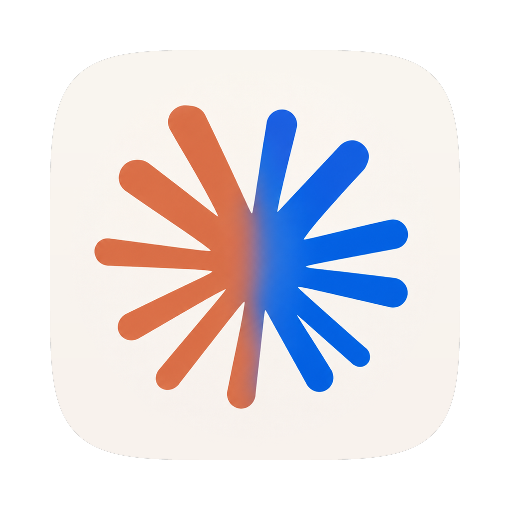
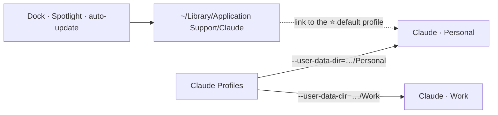

<div align="center">



# Claude Profiles

**Two Claude Desktop accounts on one computer. Switch without signing out.**

[](#macos)
[](#ubuntu--debian)
[](Sources/ClaudeProfiles)
[](LICENSE)

</div>

---

Claude Profiles is a small, local launcher for the official Claude Desktop app.
Each profile (for example **Personal** and **Work**) runs Claude with its own
data folder, so each one keeps its own sign-in, settings, chats and local
history. Both can be open at the same time.

No server, no analytics, no cloud sync. It doesn't modify Claude.

## Features

- 🔐 **Separate sign-ins.** Every profile has its own Electron `--user-data-dir`.
- ⭐ **Default profile.** Starting Claude from the Dock, from Spotlight or after an auto-update opens the default profile, already signed in.
- 🟢 **Accurate status.** Running profiles are found from the real arguments of each Claude process, so the status stays right after relaunches.
- 🧭 **Safe sign-in.** When a new profile needs to sign in, the launcher offers to close the other profile first, so the accounts don't get mixed up.
- 🗑️ **Recoverable removal.** Removing a profile moves its data to the Trash. Nothing is deleted outright.
- 🐧 **macOS and Linux.** A native AppKit app on macOS and a Tkinter app on Ubuntu/Debian.

## How it works



Claude is an Electron app, and Electron keeps everything it stores in one data
folder. The launcher gives each profile its own folder. Claude can also start
without the launcher: from the Dock, from a `claude://` link, or when it
relaunches itself after an update. To cover those starts, Claude's standard
folder becomes a link to the profile marked with a star. If a real folder is
already there, the launcher leaves it alone and says so in its window.

## Install

### macOS

Requires macOS 15+, Claude Desktop in `/Applications/Claude.app`, and the Apple
Command Line Tools. You don't need the full Xcode.

```zsh
xcode-select --install
git clone https://github.com/Abror-Mirzaaxmedov/claude-profiles.git
cd claude-profiles
./scripts/build-app.sh
open "dist/Claude Profiles.app"
```

### Ubuntu / Debian

Requires Ubuntu 22.04+ or Debian 12+, the official `claude-desktop` package,
and Python 3 with Tkinter.

```bash
sudo apt install python3-tk
git clone https://github.com/Abror-Mirzaaxmedov/claude-profiles.git
cd claude-profiles
./linux/install.sh
```

Step-by-step instructions, including how to install Claude Desktop itself, are
in the **[installation guide](docs/INSTALL.md)**.

## First run

1. Open **Claude Profiles** and create `Personal`.
2. Click **Launch** and sign in. The first profile becomes the ⭐ default.
3. Create `Work`, launch it and sign in with the second account. When asked,
   let the launcher close `Personal` until you have signed in.
4. From then on, click **Launch** or **Show Claude** to move between accounts.

## Where data lives

| Platform | Profile data | Profile list |
| --- | --- | --- |
| macOS | `~/Library/Application Support/ClaudeProfiles/Profiles/` | `~/Library/Application Support/ClaudeProfiles/profiles.json` |
| Linux | `~/.local/share/ClaudeProfiles/Profiles/` | `~/.config/ClaudeProfiles/profiles.json` |

## FAQ

<details>
<summary><b>Why did Claude ask me to sign in again?</b></summary>

Claude was probably started outside the launcher, and no profile was set as
default yet. Open Claude Profiles once: it links Claude's standard folder to
the ⭐ profile. If the window says a separate Claude folder is in the way, quit
Claude and move `~/Library/Application Support/Claude` somewhere else.
</details>

<details>
<summary><b>Why do both windows have the same Dock icon?</b></summary>

All Claude windows come from the same app, so macOS shows one icon for them.
Keep Claude Profiles in the Dock and use it to switch.
</details>

<details>
<summary><b>Can I have more than two profiles?</b></summary>

The interface is deliberately limited to two: one personal and one work account.
</details>

## Limitations

This is not an Anthropic-supported multi-account feature. It relies on the
Electron `--user-data-dir` flag. After a major Claude Desktop update, open both
profiles once and confirm that the accounts are still separate.

Claude finishes browser sign-in through a `claude://` link, and macOS can hand
that link to either running instance. That's why it's best to sign in while
only that profile is open.

## Development

```zsh
swift build                                     # macOS app
python3 -m py_compile linux/claude_profiles.py  # Linux launcher
python3 linux/claude_profiles.py --diagnose     # Linux prerequisites
```

## License

[MIT](LICENSE). Claude Profiles is an independent project and is not
affiliated with or endorsed by Anthropic.
